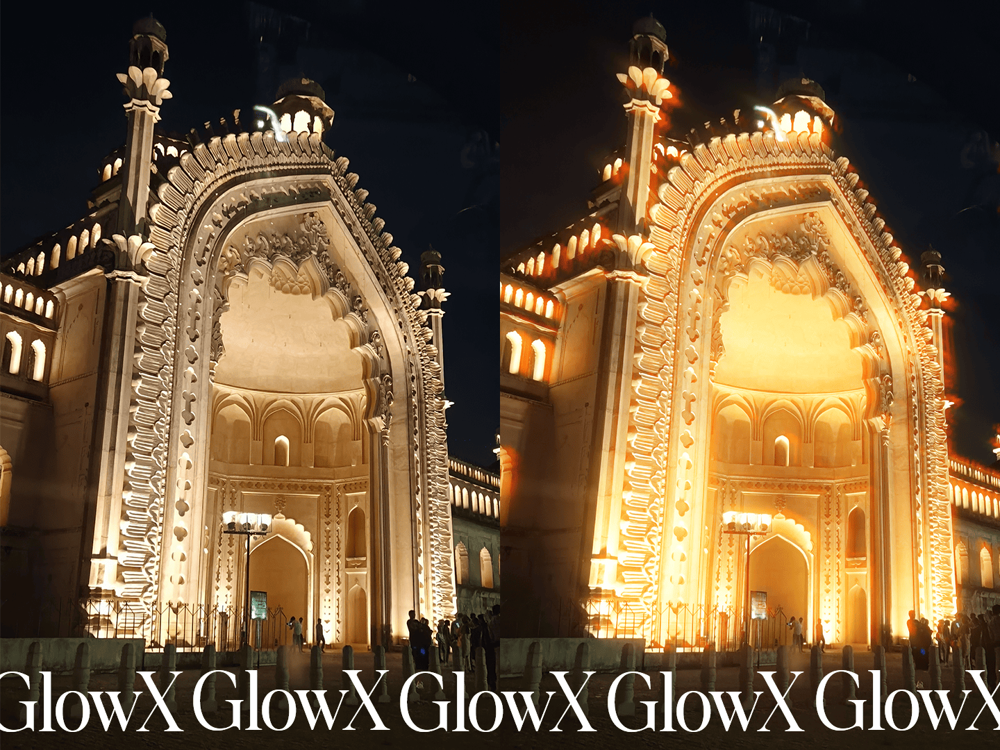

# GlowX

HDR Dual-Kawase optical bloom and depth-gated glow plugin for Adobe Photoshop.



## Features

- **6-Level Dual-Kawase Pyramid:** RGBA16F half-float downsample and upsample passes with configurable inverse-square falloff curves.
- **Directional Anamorphic Stretch:** Independent horizontal and vertical radius scaling with arbitrary angle rotation.
- **35mm Film Halation:** Wavelength-dependent red-orange scatter emulation driven by high-intensity thresholding.
- **Dual-Tone Coloration:** Independent color selection and blending for the inner core and outer halo diffusion.
- **HSV Keying:** Selective hue, saturation, and brightness qualification to isolate glow to specific target ranges.
- **Depth Anything V2 Z-Gating:** Client-side depth estimation via WebGPU/WASM to mask glow effects based on spatial depth boundaries.
- **Non-Destructive Layer Commits:** Executes full-resolution rendering pipeline and injects output back into Photoshop as dedicated layers.

## Installation

### Option A: Quick Install (.ccx)

1. Download the latest `.ccx` file from GitHub Releases.
2. Double-click the file to trigger Creative Cloud Desktop.
3. Accept the prompt to install the unverified plugin.
4. Launch Photoshop and open the panel via `Plugins > GlowX`.

### Option B: Build from Source

Requirements: Node.js 18+, Photoshop 2024 (v25.0+), and Adobe UXP Developer Tool (UDT).

```bash
# 1. Install dependencies
npm install

# 2. Build plugin and webview bundle
npm run build

# 3. Load into Photoshop
# Open Adobe UXP Developer Tool -> Add Plugin -> Select dist/manifest.json -> Click Load
```

## Tech Stack & License

Built with React, Vite, TypeScript, WebGL2, and Hugging Face Transformers.js (`onnx-community/Depth-Anything-V2-Small`).

Licensed under the MIT License.
